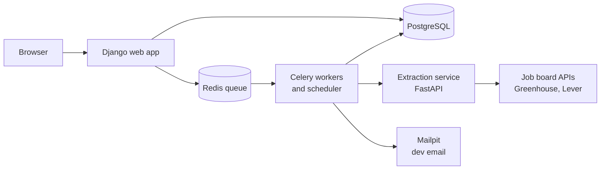

# Shortlist

**Shortlist** (working name) pulls internship postings from employers' public job boards, uses AI to read each one for its deadline, eligibility requirements, and pay, and lets groups of students track and share applications together.

*CSCI 3340 Software Engineering 1, UTRGV, Fall 2026.*

> **Status (Deliverable 1, Oct 23):** the Django project runs locally, and the plan, issues, and user stories are in place. Features are being built over the next sprints.

---

## The problem

Internship postings are scattered across dozens of sites. The facts that decide whether you can even apply (deadline, U.S. citizenship, security clearance, degree level, pay) are buried in long descriptions. Deadlines get missed and friends applying to the same programs don't share what they know.

## What it does

| Area | Features |
| --- | --- |
| **Discover** | A shared catalog of internships, synced automatically from Greenhouse and Lever job boards every 6 hours. Filter by citizenship, clearance, degree level, work mode, deadline, pay, and keyword. |
| **AI reading** | Each posting's description is read for the facts the job board doesn't provide. Every fact shows where it came from; uncertain ones go to a review queue where people confirm or fix them. |
| **Add by hand** | For employers without a supported job board: paste the text or upload a PDF. |
| **Boards** | Create a board, invite friends with a join code, save postings to it, and comment privately. |
| **Tracker** | Track each application through a status pipeline (saved → applied → interview → offer) and add tasks with due dates. |
| **Reminders** | A daily digest (in the app and by email) of tasks due soon, approaching deadlines, and new postings matching your saved searches. |
| **Home** | What matters this week: upcoming deadlines, applications by status, and new postings on your boards. |

## How it works



- **Django** serves the pages and stores everything in **PostgreSQL**.
- Slow work (syncing job boards, AI reading, sending email) runs in the background on **Celery workers**, so pages never wait on it. **Redis** holds the queue of waiting jobs.
- The **extraction service** is a separate program in its own container. The app talks to it only through `apps/extraction_client`, and a stub mode lets everyone build without it running.

## Tech stack

| Tool | What it does here | Why we chose it |
| --- | --- | --- |
| Django | Web app: pages, accounts, admin | Python like the AI side; built-in login, password reset, and admin |
| PostgreSQL | Database | Handles many writers at once (the site, workers, and sync); SQLite allows one writer at a time |
| Celery + Redis | Background jobs and the queue | The best-documented Python option; Celery Beat runs the scheduled sync and digest |
| FastAPI | The extraction service | Small, fast, and keeps the heavy AI libraries out of the website |
| Tailwind CSS (`django-tailwind-cli`) | Styling | Style in the templates; no Node.js needed *(pending, #24)* |
| Docker Compose | Runs every service with one command | Same setup on every laptop *(in progress, #9)* |
| uv | Python versions and packages | One command installs exact, locked versions |
| ruff, pyright, GitHub Actions | Lint, format, type checks on every push | Catches mistakes before they reach `main` |

## Run it locally

**You need:** [Git](https://git-scm.com/) and [uv](https://docs.astral.sh/uv/getting-started/installation/).

```powershell
git clone https://github.com/mxndo-man/CSCI3340-Project.git
cd CSCI3340-Project
uv sync
Copy-Item .env.example .env        # macOS/Linux: cp .env.example .env
uv run python manage.py migrate
uv run python manage.py runserver
```

Open http://127.0.0.1:8000/admin/ to check it's running. The home page (`/`) shows "Page not found" until the landing page is added (#10). This behavior is expected.

| Task | Command |
| --- | --- |
| Admin login for yourself | `uv run python manage.py createsuperuser`, then visit `/admin/` |
| Run the tests | `uv run python manage.py test` |
| Format and lint before a PR | `uv run ruff format .` then `uv run ruff check . --fix` |
| Add a package | `uv add <package>` (never `pip install`); commit `uv.lock` |

**Coming soon:** `docker compose up` will run the whole system (#9). Once the Tailwind PR merges, `uv run task run` starts Django and the CSS watcher together.

## Project layout

```
config/      settings, root URLs, Celery
apps/        one folder per feature: accounts, boards, postings, tracker,
             notifications, ingestion, extraction_client
templates/   base.html (shared layout) and one folder per app
static/      project CSS, JS, images
fixtures/    fake sample data for development
docs/        contracts.md, research/, wireframes/ (published, so nothing private)
```

## Team

| Person | Role | Owns |
| --- | --- | --- |
| [@liamreeves34](https://github.com/liamreeves34) | data pipeline and AI lead | Job-board sync (`ingestion`), `extraction_client`, the extraction service, README and backlog |
| [@mxndo-man](https://github.com/mxndo-man) | Tech lead | Repo, CI, Docker Compose, settings; boards; postings (Discover, review queue, comments); home dashboard; code review lead |
| [@Azaelp2005](https://github.com/Azaelp2005) | Accounts, tracker, & notifications | Accounts; applications and tasks; notifications; wireframes |

Each owner builds inside their own apps. Shared files (`base.html`, `config/settings.py`, `pyproject.toml`, `uv.lock`, CI) change only through a PR all three approve.

## Agile planning

**Cadence**
- **One-week sprints, Thursday to Wednesday,** so the Wednesday class status update is the board itself: done, in progress, next.

**Work items**
- One GitHub issue per app or feature, plus integration issues where apps connect. Each has an owner, labels, and a milestone (D1 Oct 23, D2 Nov 14, Final Dec 7).
- **User stories** take the form *"As a ___, I want ___ so that ___,"* with acceptance criteria. The product owner orders the backlog. First draft: [`docs/user_stories.md`](docs/user_stories.md)

**Sprint plan**

| Sprint | Dates | Goal |
| --- | --- | --- |
| 0 | Oct 8–14 | Repo, CI, Django skeleton, issues |
| 1 | Oct 15–21 | Foundation: base layout, contracts agreed, README, branch rules, extractor stub |
| 2 | Oct 22–28 | **D1 (Oct 23)**; Docker Compose; sign-up and login; user interviews |
| 3 | Oct 29–Nov 4 | Boards, postings, job-board sync in development; wireframes drafted |
| 4 | Nov 5–11 | Home dashboard, Discover, add by hand; wireframes final |
| 5 | Nov 12–18 | **D2 (Nov 14)**; applications and tasks |
| 6 | Nov 19–25 | AI reading on synced postings, review queue, reminders |
| 7 | Nov 26–Dec 2 | Saved-search alerts, polish, tests (Thanksgiving week) |
| 8 | Dec 3–7 | Feature freeze Dec 3; **final demo Mon Dec 7** |

**Branches and pull requests**
- One branch per issue: `feature/<issue#>-<short-name>`. Never commit to `main`.
- PR descriptions say `Closes #N` and cover what changed, why, and how it was tested.
- Merging needs **one approval and green CI** (lockfile check, ruff lint and format, pyright). Run the Django tests locally before opening a PR.
- Only an app's owner creates migrations for it.
- **Foundation before features:** no models or feature code merges until the contracts ([`docs/contracts.md`](docs/contracts.md)) and the base layout are agreed.

**Definition of Done**
- [ ] Meets the user story's acceptance criteria
- [ ] Has tests (for setup work: pasted proof, such as output or a screenshot)
- [ ] The PR explains what, why, and how it was tested
- [ ] The author can walk the team through it in about two minutes

## How we meet the course requirements

| Requirement | Where |
| --- | --- |
| Multi-user and social | Boards, the shared catalog, board comments, edit-conflict protection |
| Create / read / update / delete | Boards, postings, applications, tasks, saved searches, comments, notifications |
| Notifications and reminders | Daily digest, in the app and by email |
| SDLC and Agile | Issues, weekly sprints, Wednesday updates |