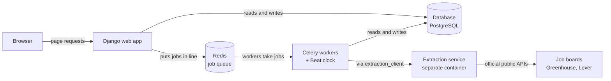
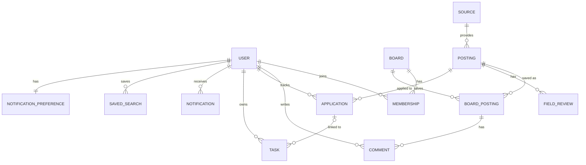
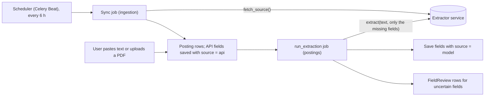

# Shortlist contracts (draft v0.2, Oct 18)

## 1. Big picture & Django specifics

**Shortlist** pulls internship postings from employers' public job boards, uses AI to read each posting for the facts students care about (deadline, citizenship and clearance requirements, degree level, pay), and lets groups of users track and share applications together.

Here's every moving part, and how they talk to each other:



The components:

- **Django web app:** our main program. It answers page requests from the browser. Django is the **web framework**: a toolkit that handles the plumbing (URLs, logins, forms, database access) so we write only the app-specific parts.
- **Database:** We use **PostgreSQL**. Until Docker Compose is set up, we use **SQLite** as a stand-in.
- **Redis job queue:** a queue for slow jobs. Django moves once a job is added to the queue instead of making the user wait. Redis only *holds* jobs; it doesn't run them.
- **Celery workers:** background programs that take jobs from the line and run them. **Beat** is Celery's clock: it adds scheduled jobs to the queue (sync every 6 hours).
- **Extraction service:** A separate program that fetches postings from job boards and reads them with AI. It runs in its own docker container.
- **Job boards:** Greenhouse and Lever publish free, official APIs listing each employer's open jobs. We ask for an employer's list of postings and get structured data back for each one.


---
## 2. Models
### 2.0 ERD



The symbols at the ends say how many connections: `||` means "exactly one," `o{` means "zero or more," and `|o` means "zero or one." So `BOARD ||--o{ MEMBERSHIP` reads "one board has zero or more memberships."

**The key idea and what makes this app "social" is that postings are shared.**
- A `Posting` is one real-world job posting, stored **once for everyone**. The discover page will list all the postings.
- When a board saves a posting, it also creates a `BoardPosting` which essentially links a post to a board. That board's comments hang off the `BoardPosting`, so other boards never see them.
- An `Application` belongs to one user and points at the shared `Posting`.

### Who owns what app (to make it more clear than the issue board)

| App | Owner | Models |
| --- | --- | --- |
| accounts | Azaelp2005 | `User` |
| boards | mxndo-man | `Board`, `Membership` |
| ingestion | liamreeves34 | `Source` |
| postings | mxndo-man | `Posting`, `BoardPosting`, `FieldReview`, `Comment` |
| tracker | Azaelp2005 | `Application`, `Task` |
| notifications | Azaelp2005 | `Notification`, `NotificationPreference`, `SavedSearch` |
| extraction_client | liamreeves34 | None since it's a module and not an app  |

### Build order

A model can only link to a model whose table already exists, so migrations have to run in this order:

```
accounts → boards → ingestion → postings → tracker → notifications
```


Here's roughly what the boards app's models could look like to show Django model basics.

```python
from django.conf import settings
from django.db import models


class Board(models.Model):
    name = models.CharField(max_length=100)
    description = models.TextField(blank=True)
    join_code = models.CharField(max_length=12, unique=True)
    created_by = models.ForeignKey(
        settings.AUTH_USER_MODEL, null=True, on_delete=models.SET_NULL
    )
    created_at = models.DateTimeField(auto_now_add=True)


class Membership(models.Model):
    class Role(models.TextChoices):
        OWNER = "OWNER"
        MEMBER = "MEMBER"

    board = models.ForeignKey(Board, on_delete=models.CASCADE)
    user = models.ForeignKey(settings.AUTH_USER_MODEL, on_delete=models.CASCADE)
    role = models.CharField(max_length=10, choices=Role.choices, default=Role.MEMBER)
    joined_at = models.DateTimeField(auto_now_add=True)

    class Meta:
        constraints = [
            models.UniqueConstraint(
                fields=["board", "user"], name="one_membership_per_user"
            )
        ]
```
notes:
- Always link to the user via `ForeignKey(settings.AUTH_USER_MODEL)`, never to `User` directly.
- Every model also gets an automatic `id`. "created / updated" means auto-filled `created_at` / `updated_at` timestamps.
- **We should use JSONField for lists:** PostgreSQL has a special list column (`ArrayField`), but it doesn't work on SQLite, which we use until Compose is ready. `JSONField` works on both.

### Shared conventions

- Every model gets an automatic `id`.
- Timestamps are `created_at` (`auto_now_add`) and `updated_at` (`auto_now`) where listed.
- Choice values are UPPERCASE strings.
- Links to users always use `settings.AUTH_USER_MODEL`.
- Links to another app's model use a string, like `"postings.Posting"`, instead of importing the class. That avoids **circular imports**: two files importing each other, which Python can't resolve.

---

### 2.1 accounts (Azaelp2005)
Every Django project has a user model: the table of accounts. Django ships one (`django.contrib.auth.models.User`). You should extend it to be a **custom user model** asap (as you have been talking about), so make edits to the following:

| | A. Custom `User`, keeps username (**recommended**) | B. Custom user, email login, no username (`Azael-Branch`) |
| --- | --- | --- |
| What it is | `accounts.User` extends `AbstractUser`, adds our three profile fields, makes email unique | `accounts.CustomUser` extends `AbstractUser`, removes `username`, logs in by email |
| Extra code needed | None | A custom manager (otherwise `createsuperuser` crashes) and a custom admin class (otherwise Django's system check fails with `admin.E033`). Both verified on Django 6.1.2. |
| Can we change our mind later? | Yes: email login can be added later with a small login add-on (an authentication backend) without changing any table | Adding usernames back later means a migration |

`User` (Option A), extending Django's `AbstractUser`, which already provides `username`, `email`, `password`, `first_name`, `last_name`, and the active and staff flags:

| Field | Type | Meaning |
| --- | --- | --- |
| email | EmailField, **unique** | Overrides AbstractUser's email to make it unique (needed if we add email login later) |
| display_name | CharField(100), blank | The name shown on boards and comments |
| graduation_term | CharField(20), blank | For example "Fall 2027" |
| timezone | CharField(50), default `"America/Chicago"` | Used to show deadlines in local time |

- Setting: `AUTH_USER_MODEL = "accounts.User"`, set **before** anyone runs `migrate` on real work.
- This replaces the separate `Profile` model from earlier plans: one table instead of two.
- **After this lands, everyone deletes their local `db.sqlite3` and runs `migrate` again.** Otherwise Django reports `Migration admin.0001_initial is applied before its dependency accounts.0001_initial`, because their database was built against the old user table.

---

### 2.2 boards (mxndo-man)
`Board`: a group of users tracking postings together.
| Field | Type | Meaning |
| --- | --- | --- |
| name | CharField(100) | Board name |
| description | TextField, blank | Optional |
| join_code | CharField(12), unique | Random code friends use to join |
| created_by | FK → User, null, `SET_NULL` | The board survives if its creator deletes their account |
| created_at | DateTimeField, auto_now_add | |


`Membership`: the link model between users and boards.
| Field | Type | Meaning |
| --- | --- | --- |
| board | FK → Board, `CASCADE` | Delete a board and its memberships go too |
| user | FK → User, `CASCADE` | |
| role | Choices: `OWNER`, `MEMBER`; default `MEMBER` | Owners can remove members |
| joined_at | DateTimeField, auto_now_add | |

Constraint: unique (board, user), so nobody joins the same board twice.

---

### 2.3 ingestion (liamreeves34)

`Source`: one employer we sync postings from.
| Field | Type | Meaning |
| --- | --- | --- |
| provider | Choices: `GREENHOUSE`, `LEVER`, `ASHBY` | Which job board API |
| token | CharField(100) | The employer's name on that job board, from its board URL (`boards.greenhouse.io/`**`examplecorp`**) |
| organization | CharField(200) | Display name, for example "Example Corp" |
| enabled | BooleanField, default True | Turns syncing off without deleting |
| added_by | FK → User, null, `SET_NULL` | Set when a user adds an employer by pasting a link |
| last_synced_at | DateTimeField, null | |
| last_error | TextField, blank | The last sync error, for debugging |

Constraint: unique (provider, token).

---

### 2.4 postings (mxndo-man)
`Posting`: one real-world posting, shared by everyone. Its fields are grouped below by purpose, but it's one model.

*Where it came from:*

| Field | Type | Meaning |
| --- | --- | --- |
| source | FK → `"ingestion.Source"`, null, `SET_NULL` | Empty for hand-added postings |
| external_id | CharField(100), blank | The posting's ID on the job board |
| source_url | URLField, blank | Link to the original posting (users apply there, never through us) |
| source_text | TextField | The plain-text description the AI reads |
| content_hash | CharField(71), indexed | Fingerprint of the text; detects duplicates and changes |
| added_by | FK → User, null, `SET_NULL` | For hand-added postings; **never shown to other users** |

*What we know about it (filled by the job board's API, the AI, or a person):*

| Field | Type | Meaning |
| --- | --- | --- |
| title | CharField(300) | |
| organization | CharField(200) | |
| deadline | DateField, null | A day, not a day-and-time; most postings only give a day |
| deadline_type | Choices: `FIXED`, `ROLLING`, `UNKNOWN`; null | `ROLLING`: reviewed as applications arrive |
| start_term | CharField(50), blank | For example "Summer 2027" |
| degree_levels | JSONField, default empty list | Any of `HS`, `ASSOCIATE`, `BACHELOR`, `MASTER`, `PHD` |
| citizenship | Choices: `US_CITIZEN`, `US_PERSON`, `WORK_AUTHORIZATION`, `NOT_SPECIFIED`; null | |
| clearance | Choices: `NONE_MENTIONED`, `ABLE_TO_OBTAIN`, `ACTIVE_REQUIRED`; null | Security clearance |
| location | CharField(200), blank | |
| work_mode | Choices: `ONSITE`, `HYBRID`, `REMOTE`, `UNSPECIFIED`; null | |
| pay_min, pay_max | DecimalField(10, 2), null | |
| pay_period | Choices: `HOUR`, `YEAR`, `UNKNOWN`; null | |
| skills | JSONField, default empty list | |
| field_sources | JSONField, default empty dict | Where each field's value came from (section 3) |
| field_details | JSONField, default empty dict | **Decision pls: should we keep this?** `FieldReview` only stores the uncertain fields; this stores confidence and evidence for every AI-filled field:`{"deadline": {"confidence": 0.94, "evidence": "Applications close November 15, 2026."}}`, so the posting page can show *why* it says what it says |

I allowed nulls in the choices field because null means "we haven't read this yet." `NOT_SPECIFIED` means "we read the posting, and it doesn't say." They aren't the same and Discover's filters need to tell them apart. an example of why this is important is bc if a student filtering out citizenship-restricted postings should still see `NOT_SPECIFIED` ones, but may want to hide unread ones.

*Bookkeeping:*

| Field | Type | Meaning |
| --- | --- | --- |
| extraction_status | Choices: `PENDING`, `EXTRACTING`, `DONE`, `FAILED`, `MANUAL`; default `PENDING` | Where the posting is in the AI pipeline (section 4) |
| extraction_model_version | CharField(50), blank | Which AI model filled the fields |
| verified | BooleanField, default False | True once every flagged field is resolved |
| status | Choices: `OPEN`, `CLOSED`; default `OPEN` | `CLOSED` when the employer takes it down |
| first_seen_at | DateTimeField | When we first saw it; used for "new posting" alerts |
| last_seen_at, closed_at | DateTimeField, null | |
| version | PositiveIntegerField, default 1 | Goes up by one on every edit (see below) |
| created_at, updated_at | DateTimeField | |

**`version` and edit conflicts:** postings are shared so two people might edit the same one at once. Without protection whoever saves second silently erases the first person's change. With `version` we can handle that conflict nicely, but implementation is up to u ofc.

Constraint: unique (source, external_id), so a sync never adds the same job twice. Hand-added postings have no source, so `content_hash` de-duplicates them instead.

Indexes on `deadline`, `citizenship`, `clearance`, and `status`. An **index** is a lookup the database keeps so filtering on that column stays fast as postings grow.


`BoardPosting`: a board's saved link to a posting.
| Field | Type | Meaning |
| --- | --- | --- |
| board | FK → `"boards.Board"`, `CASCADE` | |
| posting | FK → Posting, `CASCADE` | |
| saved_by | FK → User, null, `SET_NULL` | |
| saved_at | DateTimeField, auto_now_add | |

Constraint: unique (board, posting).

`FieldReview`: one field the AI wasn't confident about, waiting for a person.
| Field | Type | Meaning |
| --- | --- | --- |
| posting | FK → Posting, `CASCADE` | |
| field_name | CharField(50) | For example `"citizenship"` |
| proposed_value | JSONField | What the AI guessed (JSON so it can hold any field's type) |
| confidence | FloatField | 0 to 1 |
| evidence | TextField, blank | The sentence the guess came from |
| status | Choices: `PENDING`, `ACCEPTED`, `EDITED`; default `PENDING` | |
| resolved_by | FK → User, null, `SET_NULL` | |
| resolved_at | DateTimeField, null | |

`Comment`: a note on a board's saved posting.
| Field | Type | Meaning |
| --- | --- | --- |
| board_posting | FK → BoardPosting, `CASCADE` | Attached to the board's link, so comments stay inside the board |
| author | FK → User, null, `SET_NULL` | Comments survive if the author deletes their account |
| body | TextField | |
| created_at, updated_at | DateTimeField | |

---

### 2.5 tracker (Azaelp2005)
`Application`: one user's application to one posting.

| Field | Type | Meaning |
| --- | --- | --- |
| user | FK → User, `CASCADE` | |
| posting | FK → `"postings.Posting"`, `PROTECT` | A posting someone applied to can't be deleted out from under them |
| status | Choices: `SAVED`, `APPLYING`, `APPLIED`, `INTERVIEW`, `OFFER`, `REJECTED`, `WITHDRAWN`; default `SAVED` | The pipeline |
| applied_on | DateField, null | |
| next_step_at | DateTimeField, null | For example an interview time |
| notes | TextField, blank | |
| created_at, updated_at | DateTimeField | |

Constraint: unique (user, posting).

`Task`: a to-do with a due date.

| Field | Type | Meaning |
| --- | --- | --- |
| user | FK → User, `CASCADE` | |
| application | FK → Application, null, `SET_NULL` | Optional link, for example "ask for a rec letter" tied to one application |
| title | CharField(200) | |
| due_at | DateTimeField | |
| done | BooleanField, default False | |
| created_at | DateTimeField, auto_now_add | |

---

### 2.6 notifications (Azaelp2005)

`Notification`: one alert for one user, shown in the app and included in the daily email digest.

| Field | Type | Meaning |
| --- | --- | --- |
| user | FK → User, `CASCADE` | |
| kind | Choices: `TASK_DUE`, `DEADLINE_SOON`, `NEW_MATCH`, `POSTING_CLOSED` | What triggered it |
| message | CharField(300) | |
| link_url | CharField(300), blank | Where clicking it goes |
| dedupe_key | CharField(200) | For example `"TASK_DUE:task-12:2026-11-03"`; stops the same alert twice in one day |
| read | BooleanField, default False | |
| emailed | BooleanField, default False | |
| created_at | DateTimeField, auto_now_add | |

Constraint: unique (user, dedupe_key).

`NotificationPreference`: each user's settings.

| Field | Type | Meaning |
| --- | --- | --- |
| user | OneToOneField → User, `CASCADE` | **One-to-one:** each user has at most one row |
| email_enabled | BooleanField, default True | |
| digest_hour | PositiveSmallIntegerField, default 8 | Hour (0–23) in the user's time zone |

`SavedSearch`: a private, saved Discover filter.

| Field | Type | Meaning |
| --- | --- | --- |
| user | FK → User, `CASCADE` | Only its owner ever sees it |
| name | CharField(100) | |
| filters | JSONField, default empty dict | Same keys as Discover's filters, for example `{"citizenship": ["NOT_SPECIFIED"], "deadline_within_days": 30}` |
| alerts_enabled | BooleanField, default True | Include new matches in the digest |
| last_alerted_at | DateTimeField, null | Only postings first seen after this count as new |
| created_at | DateTimeField, auto_now_add | |

**Shared filter:** Discover and saved searches both use one function, `apps/postings/filters.py::filter_postings(queryset, filters)` (mxndo-man), so a saved search always matches what Discover would show.

---

## 3. Where each value comes from

A posting's information can come from four places, and `Posting.field_sources` records which one each field came from:

```json
{ "title": "api", "location": "api", "deadline": "model", "citizenship": "user" }
```

| Source | Meaning |
| --- | --- |
| `user` | A person typed it or corrected it |
| `api` | The job board's API provided it directly, already structured |
| `model` | The AI model inferred it from the description |
| `rules` | Hand-written pattern extraction rules inferred it (eg a reg expression that finds "U.S. citizenship required") |

**Precedence: `user` > `api` > (`model` and `rules`).** A value from a higher source is never overwritten by a lower one.

my hope is to use this structure to save on computation (not running the clanker unless needed). Structurally it would be nice to enforce these rules somewhere down the line:
- If someone corrects a field, re-running the AI can't undo the correction.
- If the job board gave us the title, the AI never guesses it.

**Example for one posting over time:**

```mermaid
flowchart LR
  E1[Sync finds posting] -->|"Greenhouse gives title/location,<br/>no deadline"| S1[("deadline: null<br/>source: (none)")]
  S1 --> E2[AI reads posting]
  E2 -->|"Finds 'Nov 15' (94% confident)"| S2[("deadline: 2026-11-15<br/>source: model")]
  S2 --> E3[Student corrects it]
  E3 -->|"Careers page says Nov 1"| S3[("deadline: 2026-11-01<br/>source: user")]
  S3 --> E4[Employer edits posting]
  E4 -->|"AI re-reads, skips deadline<br/>because source is 'user'"| S4[("deadline: 2026-11-01<br/>source: user")]
```


---

## 4. How the extractor service will work with this

I am building this extractor independently, but I need everyone's input because it is one of the main features of this project.

it has two jobs:
1. **Fetch:** ask Greenhouse's and Lever's public job-board APIs for an employer's internship postings.
2. **Extract:** read a posting's description and pull out what the API doesn't provide: deadline, citizenship, clearance, degree levels, start term, skills, and hopefully pay and work modality.

Django will never import the extractor's code. It talks to it over HTTP through `apps/extraction_client`, because the AI libraries are large and slow to install. Keeping them out keeps the site light, and the extractor can crash or change without taking the site down.

**The flow:**



- **Background job** (a Celery task): work that runs outside the page request, so a page never waits seconds on the model. **Never call the extractor from a view.**
- **Idempotent:** running a job twice changes nothing the second time (it exits if the posting is already done), so retrying is safe.
- **Safety:** postings are untrusted input. The extractor only returns data; it can't touch the database or take actions. Uncertain fields go to human review. It only fetches links from the supported job-board sites.

**Stub mode:** A **stub** is a stand-in that returns realistic sample data. With `EXTRACTOR_MODE=stub`, the client returns fixed sample responses, with no network and no service running. With `live`, it calls `EXTRACTOR_URL`. The response shape is identical either way, so code written against the stub works unchanged later.

**Build order**
1. Client with stub mode (#21): unblocks Armando now
2. Stub service image for Compose (#9)
3. Live fetch: Greenhouse, then Lever
4. Rules backend (live extract)
5. Teacher, then student tuning via LoRA

---

## 5. `extraction_client` (the only way Django talks to the extractor)

```python
from apps.extraction_client import extract, fetch_source, ExtractionError

result = extract(text=posting.source_text, fields=["deadline", "citizenship"])
f = result.fields["deadline"]
f.value, f.confidence, f.evidence, f.needs_review, f.source
# "2026-11-15", 0.94, "Applications close November 15, 2026.", False, "model"

for p in fetch_source(provider="greenhouse", token="examplecorp"):
    p.external_id, p.title, p.organization, p.url, p.text, p.content_hash, p.structured
```

- `extract(text=... or url=..., fields=[...])`: exactly one of `text` or `url`. `fields` lists only the fields still missing.
- `extract_file(file)` *(proposed)*: PDF upload, same result shape.
- **Any** failure (network, timeout, bad response) raises `ExtractionError`. The caller marks the posting `FAILED` and shows the manual form.

---

## 6. Extractor API v1 (the client calls these)

| Endpoint | Purpose |
| --- | --- |
| `POST /v1/extract` | Read `text` or a `url`; optional `fields` |
| `POST /v1/extract/file` | PDF upload (live mid-November but the stub will support it as soon as it's done) |
| `POST /v1/sources/fetch` | One employer's internship postings |
| `GET /healthz` | Is it up? → `{"status": "ok", "backend": "rules"}` |

**Extract request → response**
```json
{ "text": "Software Engineering Intern, Summer 2027 ...", "url": null, "fields": ["deadline"] }
```
```json
{
  "contract_version": "1.0",
  "backend": "student",
  "model_version": "student-v1",
  "latency_ms": 2140,
  "fields": {
    "deadline": { "value": "2026-11-15", "confidence": 0.94,
                  "evidence": "Applications close November 15, 2026.",
                  "needs_review": false, "source": "model" }
  },
  "warnings": []
}
```

**Fetch request → response**
```json
{ "provider": "greenhouse", "token": "examplecorp" }
```
```json
{
  "provider": "greenhouse", "token": "examplecorp", "fetched_at": "2026-11-03T14:00:00Z",
  "postings": [
    { "external_id": "4012345", "title": "Software Engineering Intern, Summer 2027",
      "organization": "Example Corp", "location_raw": "Austin, TX",
      "url": "https://boards.greenhouse.io/examplecorp/jobs/4012345",
      "updated_at": "2026-10-30T18:22:00Z", "text": "Plain-text description...",
      "content_hash": "sha256:9f2c...", "structured": { "work_mode": null, "pay": null } }
  ]
}
```
Only internships are returned: the title contains *intern*, *internship*, *co-op*, or *student* as a whole word (so "Internal Audit" doesn't count), or Lever marks the posting as an internship.

**Field values**

| Field | Values |
| --- | --- |
| title, organization, location, start_term | text |
| deadline | `YYYY-MM-DD` or null |
| deadline_type | `FIXED`, `ROLLING`, `UNKNOWN` |
| degree_levels | list of `HS`, `ASSOCIATE`, `BACHELOR`, `MASTER`, `PHD` |
| citizenship | `US_CITIZEN`, `US_PERSON`, `WORK_AUTHORIZATION`, `NOT_SPECIFIED` |
| clearance | `NONE_MENTIONED`, `ABLE_TO_OBTAIN`, `ACTIVE_REQUIRED` |
| work_mode | `ONSITE`, `HYBRID`, `REMOTE`, `UNSPECIFIED` |
| pay | `{min, max, period: HOUR / YEAR / UNKNOWN, currency}` |
| skills | list of text |

**Limits and errors.** `url` must be on `boards.greenhouse.io`, `job-boards.greenhouse.io`, `jobs.lever.co`, or `jobs.ashbyhq.com`. Text is capped at 100,000 characters. A **status code** is the number in a response saying what happened: 4xx means the request was wrong, 5xx means the server (or something it relies on) failed.

| Code | Meaning |
| --- | --- |
| 404 | Unknown employer (fetch) |
| 422 | Invalid input |
| 502 | The job board or link fetch failed |
| 503 | Backend unavailable |

---

## 7. URL names other apps use

A **URL name** lets templates link with `` instead of hardcoding paths. The part before the colon is the app's namespace (`app_name = "postings"` in its `urls.py`).

| Name | Path (can change) | Owner | Shows |
| --- | --- | --- | --- |
| `landing` | `/` | All (templates, #10) | Public landing page; logged-in users are sent to `home` |
| `home` | `/home/` | mxndo-man + Azaelp2005 (#27) | Home dashboard |
| `login`, `logout`, `password_reset`, … | `/accounts/login/` etc. | Django built-in | Django's own auth views (no namespace; see note) |
| `accounts:signup` | `/accounts/signup/` | Azaelp2005 | Sign up |
| `accounts:profile` | `/accounts/profile/` | Azaelp2005 | Profile and settings |
| `postings:discover` | `/postings/` | Armando | Discover feed |
| `postings:detail` | `/postings/<id>/` | Armando | One posting |
| `postings:add` | `/postings/add/` | Armando | Add by hand |
| `postings:review` | `/postings/<id>/review/` | Armando | Review flagged fields |
| `boards:list` | `/boards/` | Armando | My boards |
| `boards:detail` | `/boards/<id>/` | Armando | One board |
| `boards:join` | `/boards/join/` | Armando | Join with a code |
| `tracker:applications` | `/tracker/applications/` | Azaelp2005 | Applications by status |
| `tracker:application_detail` | `/tracker/applications/<id>/` | Azaelp2005 | One application |
| `tracker:tasks` | `/tracker/tasks/` | Azaelp2005 | Tasks |
| `tracker:task_detail` | `/tracker/tasks/<id>/` | Azael | One task |
| `notifications:list` | `/notifications/` | Azaelp2005 | In-app notifications |
| `notifications:saved_searches` | `/notifications/searches/` | Azaelp2005 | Saved searches |


---

## 8. Environment variables


| Variable | Example | Used by |
| --- | --- | --- |
| `DJANGO_SECRET_KEY` | (any long random string) | Django |
| `DJANGO_DEBUG` | `1` in development | Django |
| `ALLOWED_HOSTS` | `localhost,127.0.0.1` | Django |
| `DATABASE_URL` | `postgres://shortlist:...@db:5432/shortlist` (unset = SQLite) | Django |
| `REDIS_URL` | `redis://redis:6379/0` | Django, Celery |
| `EXTRACTOR_MODE` | `stub` (default) or `live` | `extraction_client` |
| `EXTRACTOR_URL` | `http://extractor:8001` | `extraction_client` (live mode) |
| `EXTRACTOR_BACKEND` | `rules`, `teacher`, or `student` | Extraction service |
| `SYNC_INTERVAL_HOURS` | `6` | Beat schedule |
| `CONNECTOR_USER_AGENT` | `Shortlist student project (team contact email)` | Extraction service: identifies us politely to job boards |
| `EMAIL_HOST`, `EMAIL_PORT` | `mailpit`, `1025` in development | Email (Mailpit catches it) |

---

## 9. Changing this after approval

Open a PR that edits `docs/contracts.md` and explains why; all three approve. For an API change, bump `contract_version`. Until #7 closes, any model code is provisional and stays on a branch.
