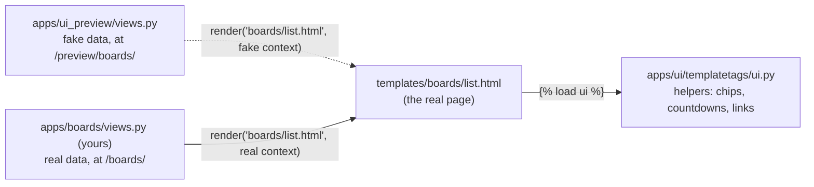

# Frontend handoff: how your backend plugs into the UI

*Branch `feature/10-ui-port`. Written by Liam with Claude. If this doc and a template's top comment disagree, the template wins; tell Liam.*

## 1. How it works

Every page's HTML is already written, in `templates/`. Those are the **real** templates, not mockups. Until your views exist, `apps/ui_preview` feeds them fake objects shaped exactly like the models in `docs/contracts.md`, at `/preview/` (only when `UI_PREVIEW=1`). Your job is the other half: a view that renders the same template with real querysets.



When your view is registered under its contract URL name, the nav and every link switch to it on their own; nobody edits `base.html`. Then the preview route for that page can be deleted.

Three apps are involved, and only one is temporary:

| App | Holds | Lifespan |
| --- | --- | --- |
| `apps/ui` | The `` helpers and `/styleguide/` (only with `DEBUG`) | Permanent. Every page needs it. |
| `apps/ui_preview` | `fake_data.py`, the preview views and `/preview/` | Deleted once every page has a real view |
| Your app | Models, views, URLs, forms | Permanent |

## 2. The rules your view follows

1. **Render the template that already exists.** `render(request, "boards/list.html", context)`. Each template's top comment lists exactly what it reads. Don't make a second template with the same name in `apps/<you>/templates/`: Django looks in `templates/` first, so yours would never be used.
2. **Pass real objects; prefetch their relations.** The helpers read the contracts' relations directly (for example `board.membership_set`), so you don't add extra attributes. Use `prefetch_related` so each card doesn't run its own query.
3. **Give each model a `get_absolute_url()`.** Templates link to objects only with `{{ obj.get_absolute_url }}`, never a hard-coded path, so the same template works on fake and real objects. Without it, the link is empty and clicking it goes nowhere, with no error.
   ```python
   def get_absolute_url(self):
       return reverse("boards:detail", args=[self.pk])
   ```
4. **Forms post through ``.** It returns, in order: the view's `form_urls[action]` if you passed one (the preview passes all of them), else the real URL listed in `FORM_URL_NAMES` in `apps/ui/templatetags/ui.py`, else `""`. Once your form view exists, add its URL name to `FORM_URL_NAMES` and you don't need `form_urls` at all. Every form also posts `next` (the page it came from); redirect there after saving if it's safe (`url_has_allowed_host_and_scheme`).
5. **Use Django messages for feedback.** `messages.success(request, "...")` shows as a toast in `base.html`.

### Going live, for any page

1. Write the view; render the existing template with the context in its top comment (and in section 3 below).
2. Register it under the contract URL name (contracts section 7). The nav and links switch to it.
3. Add `get_absolute_url()` to your models.
4. Add your form views' URL names to `FORM_URL_NAMES`.
5. Delete the page's route from `apps/ui_preview/urls.py` and its entry in `PREVIEW_PAGES` (in `ui.py`) and `INDEX_PAGES` (in `apps/ui_preview/views.py`).
6. Check it at 1440 and 390 pixels wide, logged in and logged out.

## 3. Pages

### Boards (Armando)

**Status: almost live.** Your PR #40 was trial-merged with this branch and tested with real users and boards: the list, detail, create and join pages render with your views as they are, and create, join (including a wrong code), leave, remove and "owner can't leave" all work through these templates.

**To finish:**

1. Add `Board.get_absolute_url()` (rule 3). It's the one thing missing: without it, board cards on `/boards/` link nowhere.
2. Delete `apps/boards/templates/boards/` (all four files). The ones in `templates/boards/` replace them and read the same context your views pass (`boards`; `board`, `members`, `is_owner`; `form`).
3. Prefetch: `Board.objects.filter(membership__user=request.user).prefetch_related("membership_set__user")`, plus `"boardposting_set__posting"` once BoardPosting exists. On the detail page, prefetch `membership_set__user` too.
4. When `BoardPosting` and `Comment` exist: pass `board_postings`, `selected` and `comments` to the detail page (below), add the comment view, and add `"comment"` to `FORM_URL_NAMES`.
5. Ask the team: add `boards:create`, `boards:leave` and `boards:remove` to contracts section 7 (they're yours but not listed).

| Template | URL name | Context it reads |
| --- | --- | --- |
| `boards/list.html` | `boards:list` | `boards` (the user's boards) |
| `boards/detail.html` | `boards:detail` | `board`; once they exist: `board_postings` (each with `posting`, `saved_by`, `comment_count`), `selected` (the BoardPosting from `?item=<id>`, else the first), `comments` (the selected one's, oldest first) |
| `boards/create.html` | `boards:create` | `form` (`BoardForm`: `name`, `description`) |
| `boards/join.html` | `boards:join` | `form` (`JoinBoardForm`: `join_code`) |
| `boards/partials/board_card.html`, `member_stack.html` | (partials) | `board` |

Members, the member count, roles and the Leave and Remove buttons all come from `board.membership_set` through the helpers `memberships`, `board_members`, `member_count` and `board_role`. Owners see Remove next to each member; members see Leave; owners can't leave or be removed, the same rules as your services.

| Form | Posts to | Fields |
| --- | --- | --- |
| New board dialog (list) and `create.html` | `boards:create` | `name`, `description`, `next` |
| Join dialog (list) and `join.html` | `boards:join` | `join_code`, `next` |
| Leave (detail, Members dialog) | `boards:leave <board id>` | `next` |
| Remove (detail, Members dialog) | `boards:remove <board id> <user id>` | `next` |
| Comment (detail) | `form_urls.comment` until it exists | `board_posting`, `body`, `next` |

`/boards/?new=1` opens the New board dialog; the "Save to a board" menu links there.

### Postings (Armando, with Liam for review and add)

| Template | URL name | Context it reads |
| --- | --- | --- |
| `postings/discover.html` | `postings:discover` | `page_obj` (`Paginator(postings, 6).get_page(...)`), `filters`, `sort` (`closing`, `newest` or `pay`), `start_terms`, `total_count`, `employer_count`, `last_synced_at`, `search_saved`, `my_boards` |
| `postings/detail.html` | `postings:detail` | `posting`, `reviews` (its PENDING FieldReviews), `application` (the user's, or None), `my_boards` |
| `postings/add.html` | `postings:add` | nothing; one multipart form |

- **Filters.** `apps/ui_preview/filters.py` is a plain-Python version of what `apps/postings/filters.py::filter_postings()` must do with a queryset (contracts section 2.6): the query-string keys (`q`, `paid`, `deadline_within_days`, `citizenship`, `clearance`, `degree_levels`, `work_mode`, `start_term`; lists are comma-separated), the defaults with no filters, and the three sorts. Copy its rules, not its code. Saved searches store the same dict, so `parse_filters` is worth moving into your app as-is.
- **`my_boards`** is the user's boards with `prefetch_related("boardposting_set")`, so the save menu can tick the boards that already hold a posting.

| Form | Action | Fields |
| --- | --- | --- |
| Save to a board / remove from a board (save menu) | `save_to_board`, `remove_from_board` | `board`, `posting`, `next` |
| Save this search (Discover) | `save_search` | `name`, `filters` (JSON), `next` |
| Track this application (detail) | `track` | `posting`, `next` |
| Looks right / Fix it (fact tiles) | `review_field` | `review`, `status` (`ACCEPTED` or `EDITED`), `value` (pay sends `pay_min`, `pay_max`, `pay_period`; degree sends one `value` per level), `next` |
| Add a posting | `add_posting` | `source_url` or `source_text` or `pdf`, `next` |

None of these have URL names yet: until they do, pass `form_urls={"save_to_board": reverse(...), ...}`, then move each into `FORM_URL_NAMES`.

### Home (Armando and Azael)

*Added later in this branch: `templates/pages/home.html` on preview data. Until then `/home/` is a placeholder (`pages/home_placeholder.html`).*

### Accounts (Azael)

**Live already.** `registration/login.html`, `accounts/signup.html` and `accounts/profile.html` were restyled with your views and forms unchanged (templates only). Notes:

- The prototype logs people in right after sign-up; today sign-up sends them to the log-in page. Your call.
- The contracts call the field `timezone`; the model has `time_zone`. Pick one and update the other.
- The unused `accounts/index.html`, `register.html` and `test_page.html` are still there; delete them when you're ready.

### Tracker and notifications (Azael)

*Added later in this branch: applications by status, tasks, the notification bell (the `nav_notifications` slot in `base.html`), saved searches and notification settings.*

### Extraction review (Liam): how FieldReview and field_details feed the fact tiles

The posting page shows eight "Key facts" tiles from ``. For each field:

- **A pending FieldReview wins.** The tile shows its `proposed_value`, "Read by AI · N% sure" from its `confidence`, its `evidence` as the quote, and the Looks right / Fix it forms.
- **Otherwise it reads the posting:** the value from the field, the source line from `Posting.field_sources[field]` (`api` → "From Greenhouse", `model` → "Read by AI", `rules` → "Read by our rules", `user` → "Checked by a student"), and the confidence and quote from `Posting.field_details[field]` (`{"confidence": 0.94, "evidence": "..."}`).
- A field that's null hasn't been read yet, and says "Not read yet" instead of guessing.

**Open decision: `field_details`** (contracts section 2.4). Without it, only fields with a FieldReview have a quote and a confidence; the others show just the value and its source. The extractor already returns confidence and evidence for every field (contracts section 6), so storing them is a JSONField and one line in the ingestion job.

## 4. The helpers (``)

| Helper | Use |
| --- | --- |
| `button_class`, `icon`, `ui_widget` | Button classes, inline Lucide icons, a styled form input |
| `display_name`, `first_name`, `initials`, `avatar_tone` | How a person is shown |
| `posting_chips`, `facts_for`, `fact_source`, `countdown`, `work_mode_label`, `provider_label` | Posting facts, written against the contracts' choice values |
| `discover_menus`, `active_filter_count`, `describe_filters`, `filters_json` | Discover's filters |
| `memberships`, `board_members`, `member_count`, `board_role`, `board_postings`, `member_overflow`, `boards_with` | Boards, read from `membership_set` and `boardposting_set` |
| `page_url "<url name>"` | A link to a page, or `""` if it doesn't exist yet (the nav shows plain text then) |
| `form_url "<action>" [args]` | Where a form posts (rule 4) |
| `main_nav` | The top bar's links |

Components to `` are in `templates/components/`; `/styleguide/` (with `DEBUG` on) shows every one with its markup.

## 5. Differences from the prototype (the contracts win)

| Topic | Prototype | What the templates do |
| --- | --- | --- |
| Pay | One hourly number | `pay_min`, `pay_max`, `pay_period` (`HOUR`, `YEAR`, `UNKNOWN`) |
| Degree | One value | A `degree_levels` list |
| Citizenship | any / us / us-only | `US_CITIZEN`, `US_PERSON`, `WORK_AUTHORIZATION`, `NOT_SPECIFIED`; null is "not read yet" |
| Clearance | Yes or no | `NONE_MENTIONED`, `ABLE_TO_OBTAIN`, `ACTIVE_REQUIRED` |
| Work mode | Three values | Adds `UNSPECIFIED` |
| Private boards | Yes | No: the contracts have no field for it, so every board has a join code |
| Join codes | `K7Q-2M9` style | 12 characters, mixed case, case-sensitive (`secrets.token_urlsafe(9)` in the boards app) |
| Leave and remove members | Not in the prototype | A Members dialog on the board page (the boards app supports both) |
| Fact tiles | A quote and confidence on every fact | Only where `field_details` or a FieldReview has them (section 3, Extraction review) |
| Routes | `/discover`, `/posting/<id>`, `/add`, `/settings` | `postings:discover`, `postings:detail`, `postings:add`, `accounts:profile` |

## 6. Open decisions

| Decision | Who | Notes |
| --- | --- | --- |
| Store `Posting.field_details`? | All | Section 3, Extraction review |
| Who sees a board's join code? | Armando, all | The prototype and these templates show it to every member (so anyone can invite a friend); PR #40's own templates showed it to the owner only |
| New join code after removing someone? | Armando | Today a removed member can rejoin with the same code. Rotating the code on removal (or an owner-only "new code" button) fixes it |
| Add `boards:create`, `boards:leave`, `boards:remove` to contracts section 7 | All | They exist in PR #40 |
| `time_zone` or `timezone` | Azael | Section 3, Accounts |
| Keep committing `static/css/tailwind.css`? | All | It's generated, so it conflicts on most merges. Until we stop committing it: resolve a conflict by taking either side, then run `uv run python manage.py tailwind build` and commit the result |
